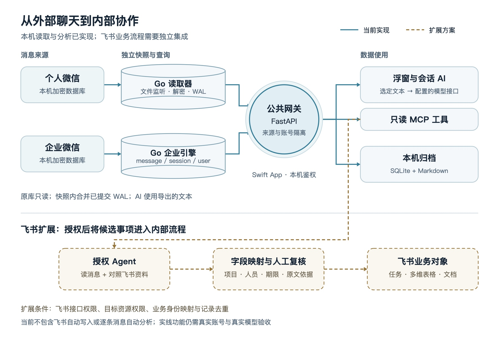

# 微信/企微连接器：面向飞书协作团队的数据连接与分析方案

云文档：[在线阅读](https://bytedance.larkoffice.com/docx/MkswdZQdNo4zznx6MThcLX2vnUh)

项目介绍、客户场景与技术原理｜2026 年 11 月 22 日｜本地版本 2.0.2-dev

很多团队把项目计划、知识库和业务台账放在飞书，客户、供应商与合作伙伴的沟通却持续发生在微信和企业微信。需求变更、交付承诺、投诉反馈与付款线索留在聊天中，内部同事需要反复查找、转述和补录。微信/企微连接器围绕这一交接环节，提供本机消息读取、检索、归档、会话 AI 分析和只读 MCP 工具，帮助团队把外部沟通转化为可核对的业务材料。

**当前产品定位是部署在个人电脑上的数据连接与分析工具。**已经实现的链路覆盖个人微信、企业微信和授权 Agent；飞书资料读取、任务创建、多维表格写入需要接入飞书接口并另行授权。实时能力目前体现为持续刷新消息与增量归档，AI 总结和草稿按选定会话触发。上述范围以仓库代码和开发验证记录为依据。[[1]](https://github.com/lamp-cat/Connector-for-WeChat-and-WeCom/blob/ad6883d22bb542b91bfb197ffa6c62ded5d44189/README.md)[[2]](https://github.com/lamp-cat/Connector-for-WeChat-and-WeCom/blob/ad6883d22bb542b91bfb197ffa6c62ded5d44189/docs/开发与验证报告.md)

## 1. 哪些客户最需要跨平台连接

需求强度取决于沟通和执行是否长期分布在不同平台。企业微信官方将客户联系、上下游协作及零售、制造、教育等列为应用场景；飞书公开客户案例也呈现了多工具沟通、碎片信息和供应商协作的问题。这些材料支持场景判断，不能证明相关企业使用了本项目，也不能证明其同时使用全部三个平台。下表是据此形成的客户画像假设，仍需访谈与试点验证。[[3]](https://work.weixin.qq.com/)[[4]](https://www.feishu.cn/customers/dishang)[[5]](https://www.feishu.cn/customers/xibei1)

| 客户类型 | 三平台并用的典型原因 | 最有价值的数据交接 | 试点优先级 |
| --- | --- | --- | --- |
| B2B 软件、SaaS、实施与外包交付团队 | 内部在飞书管理需求和项目；客户项目群、售后沟通在微信或企业微信。 | 把需求变更、验收条件、故障反馈和交付承诺整理为待核对事项，再写入项目台账。 | 优先；事项可追踪、交接频繁。 |
| 咨询、专业服务、营销与代运营公司 | 客户沟通渠道由客户决定；内部用飞书安排人员、维护方案和交付资料。 | 提取客户反馈、修改意见、会议约定与下一步动作，降低交接时的遗漏。 | 优先；多人协作与项目并行突出。 |
| 制造、贸易、经销与供应链团队 | 内部在飞书维护订单和采购流程；供应商、经销商与客户使用微信或企业微信。 | 关联交期变动、缺料、质量问题、报价条件及回款沟通，补充订单异常台账。 | 优先；需先统一订单与客户标识。 |
| 连锁门店与本地服务运营 | 总部在飞书组织运营；门店对客、区域合作与私域服务在微信生态内。 | 整理客诉、服务承诺、活动反馈与区域问题，形成门店跟进记录。 | 其次；先解决门店与客户映射。 |
| 招聘、人力服务与猎头机构 | 内部在飞书跟踪岗位和项目；候选人、用人方以微信或企业微信沟通。 | 提取面试时间、岗位要求变更、候选人反馈及跟进节点。 | 其次；明确个人信息处理范围。 |
| 教育培训与课程服务团队 | 内部在飞书安排教学和运营；学员、家长通过微信或企业微信联系。 | 整理课程调整、咨询反馈、服务问题和待回访事项。 | 其次；需收窄数据与人员范围。 |

优先客户有四个共同条件：内部已经稳定使用飞书；外部沟通确实无法全部迁入飞书；聊天中的事项经常需要交给另一位同事处理；组织允许在明确授权下处理相关本机数据。单纯聊天量大，未必意味着本项目有足够价值。更合适的切入点是“消息多、交接多、漏项后果明确”的业务流程。

产品的首批使用者可以是项目经理、客户成功经理、业务负责人或供应链协调人员。他们需要把自己能访问的外部沟通整理给内部团队。当前架构适合以个人或小团队试点，组织级全员采集、统一权限和后台运营仍需要额外建设。

## 2. 解决的核心问题：聊天信息如何进入业务流程

跨平台协作的困难通常发生在四个环节：消息难找、上下文难补、业务事项难提取、内部台账难更新。聊天记录是一连串按时间排列的表达，飞书任务和业务表格则需要明确的负责人、对象、期限与状态。连接工具的价值在于保留上下文并提供结构化入口，使执行人员可以核对“谁在什么时间说了什么”，再决定是否更新业务记录。

例如，一家实施服务公司在飞书管理交付计划，客户在企业微信群提出“周五之前补充报表，并调整验收范围”。微信/企微连接器可以检索相关消息、展示会话上下文并生成总结和待办线索。接入飞书后，授权 Agent 可进一步对照项目资料，由项目经理确认需求、责任人和期限，再创建任务或更新台账。这个例子说明目标工作方式，并非已上线客户案例；自动识别项目、匹配飞书成员与写回台账属于扩展能力。

价值评估应围绕交接结果开展：整理一次客户沟通需要多久、重要事项是否遗漏、提取结果是否有原文依据、更新台账需要多少人工操作。项目目前没有经过真实客户试点得出的效率或收益数字，因此不承诺固定节省比例。

## 3. 当前项目已经具备哪些功能

统一版在同一个 macOS App 中切换个人微信与企业微信，共用浮窗、设置页、鉴权和 AI 配置；底层为两种来源保留各自的读取引擎。企业微信使用当前所选会话或最近活跃会话作为浮窗上下文估计，用户可以手动选定并锁定会话。[[1]](https://github.com/lamp-cat/Connector-for-WeChat-and-WeCom/blob/ad6883d22bb542b91bfb197ffa6c62ded5d44189/README.md)

| 功能 | 当前行为 | 使用价值与边界 |
| --- | --- | --- |
| 来源与会话切换 | 同一 App 查看两种来源的会话、消息、搜索与分页。 | 减少分别查阅的操作；切换来源后保留隔离，当前不提供跨来源全量联合搜索。 |
| 会话 AI 分析 | 将选定上下文交给兼容 OpenAI 接口的模型，生成总结、待办线索和回复草稿。 | 辅助理解与回复；草稿供复制，项目没有聊天发送接口。结论仍需对照原文核验。 |
| 本机消息归档 | 按来源与账号保存 SQLite 和 Markdown，记录同步进度，开关默认关闭。 | 便于检索、留存和被其他工具读取；姓名、会话名与原文仍可能含个人信息。 |
| 只读 MCP | 个人微信提供 10 个工具；企业微信提供 6 个工具并独立授权。 | Agent 可以列会话、查联系人、读消息、搜索与取增量；需要客户端实际支持并完成连接。 |
| 账号与授权隔离 | 归档按来源、账号分目录；企业 MCP 使用专用令牌并绑定账号。 | 降低切换账号后串读、串归档的风险；组织成员权限与业务对象权限需另行设计。 |
| Agent 工具接入指引 | 提供对应服务配置、登记与撤销能力；列表包含豆包工作检测和手动接入说明。 | 豆包工作尚未完成真实 MCP 握手验收；安装检测仅表示客户端存在，不能当作已连接。 |
| 来源适配差异 | 个人微信沿用已有媒体能力；企业微信读取文本及结构化信息。 | 企业微信媒体本体、成员列表尚未接入；会话类型与本人身份显示未知，不自动推断。 |

截至本版本，系统已经完成统一壳、查询、隔离、归档和 MCP 等开发验证。真实账号连接、真实模型效果、真实 Agent 客户端连接和长时间运行表现仍待实机验收。功能说明应同时保留这项状态，避免把开发测试结果理解为生产适配保证。[[2]](https://github.com/lamp-cat/Connector-for-WeChat-and-WeCom/blob/ad6883d22bb542b91bfb197ffa6c62ded5d44189/docs/开发与验证报告.md)

## 4. 打通飞书的工作原理

目标链路可以分为“读取外部沟通—保留可核对数据—提取业务事项—进入内部流程”。下图实线表示当前实现，虚线表示飞书扩展。图中 AI 读取的是导出的消息文本；飞书写入则通过另行授权的 Agent 和飞书接口完成。

[架构图 SVG 源文件](项目介绍架构图.svg)

当前 2.0.2 链路的文字说明：Swift 原生 App 调用公共 FastAPI 网关；网关分别连接个人微信 Go 读取器和企业微信 Go 引擎，后者通过本机管道通信。两个读取引擎在独立快照上查询消息。结果用于浮窗显示、按需 AI 分析、只读 MCP 和本机归档。飞书扩展在 MCP 之外增加项目资料读取、业务字段映射、人工复核与写入接口。下文固定提交链接记录迁移前的设计来源；当前企业实现位于仓库的 [`wechat-realtime-reader/internal/wecom/`](https://github.com/lamp-cat/Connector-for-WeChat-and-WeCom/tree/main/wechat-realtime-reader/internal/wecom)。

### 4.1 连接的是业务上下文

本项目先把微信与企业微信的消息变成可查询的本机数据，再让授权 Agent 获取其中的业务上下文。Agent 若同时获得飞书工具权限，就可以对照项目文档、任务清单或多维表格，形成一个跨平台工作过程。MCP 负责标准化工具发现和调用；它不会自动授予飞书权限，也不会自动建立微信联系人与飞书成员之间的关系。[[6]](https://modelcontextprotocol.io/docs/learn/architecture)

### 4.2 把消息变成可复核的事件

扩展时应先定义业务事件，而后决定要写哪个飞书对象。例如“需求变更”需要项目标识、变更内容、提出人、原文时间、处理状态和负责人；“交期异常”需要订单、原计划、新计划、影响与跟进人。模型可以生成候选字段，但项目归属、同名人员、相对日期和承诺状态应由规则或人员核对，缺失字段应保留为待确认。

建议保留消息来源、账号、会话、时间和稳定消息标识，供人员返回本工具或归档检查依据。飞书目标表中的记录还应保留处理状态和复核人。当前项目没有自动跨平台身份合并，也没有自动项目匹配；这些映射是试点需要补充的业务配置。

### 4.3 通过飞书接口写入业务对象

飞书多维表格新增记录需要应用凭证、接口权限、目标文档访问权限及字段映射。飞书任务同样需要正确的成员身份、期限和清单信息。具备接口调用权限后，仍需由组织确定哪些消息可进入共享空间、哪些记录必须先复核。当前仓库没有内置飞书读取与自动写入，因此完整落地需要在授权 Agent 或独立集成服务中完成这部分工程。[[7]](https://open.feishu.cn/document/server-docs/docs/bitable-v1/app-table-record/create?lang=zh-CN)[[8]](https://open.feishu.cn/document/task-v2/task/overview?lang=zh-CN)

## 5. “实时分析”在当前版本中意味着什么

应把消息发现、界面刷新、归档更新和 AI 分析分别理解。个人微信读取器监听文件变化，使用约 300 毫秒防抖再同步快照；企业微信引擎约每 5 秒检查快照变化；界面消息约每 4 秒刷新；归档默认约每 15 秒执行同步。这些是调度参数，实际延迟还受客户端写入、数据库体积、快照处理和模型接口响应影响，不构成端到端时效承诺。[[9]](https://github.com/lamp-cat/Connector-for-WeChat-and-WeCom/blob/ad6883d22bb542b91bfb197ffa6c62ded5d44189/wechat-realtime-reader/internal/snapshot/syncer.go)[[10]](https://github.com/lamp-cat/Connector-for-WeChat-and-WeCom/blob/ad6883d22bb542b91bfb197ffa6c62ded5d44189/wechat-frontend/app/sources/wecom_engine/engine.py)

**当前 AI 处理选定会话的上下文，可按需或在切换会话时触发；新消息到来主要刷新消息显示。**企业 MCP 的增量工具可供外部 Agent 拉取新增消息，但持续调度、逐条分析与飞书自动更新仍需集成。把每条消息都交给模型，既会增加成本，也容易把随口讨论、引用历史内容或重复确认误判成业务事件。

如果要实现连续业务分析，建议以游标拉取增量，合并同一会话的短时消息，按业务规则筛选候选事件，生成有原文依据的结果，经过复核后写入飞书。还需补齐去重、失败重试、异常告警、模型调用预算及历史回补策略。晚到且发送时间早于既有游标的消息，需要额外处理，不能只依赖“时间更晚”来判断新增。

适合第一阶段连续关注的事件包括需求变更、交期异常、投诉升级和待回访提醒。自动更新优先选择风险较低、可撤回的候选记录；付款结论、验收承诺和对外发送等高影响动作，应保留人工决策。试点需要实测“客户端出现消息—本工具可读—候选事件生成—飞书可见”的完整延迟。

## 6. 底层原理：如何稳定读取消息并保持数据边界

### 6.1 本机架构与两套来源适配

App 使用 Swift 提供 macOS 原生壳，公共 FastAPI 网关监听 127.0.0.1:8088。个人微信 Go 读取器监听 127.0.0.1:5678，企业微信 Go 引擎通过继承的本机管道与网关交互。统一接口处理来源选择、查询、AI、归档与 MCP；Go 读取器处理不同客户端的账号、数据库、加密和字段差异。这种分工让两种来源共用操作界面，同时维持独立数据语义。公共 Python 网关继续提供业务服务，企业消息读取无需 Python 加密或 Frida 依赖。[[1]](https://github.com/lamp-cat/Connector-for-WeChat-and-WeCom/blob/ad6883d22bb542b91bfb197ffa6c62ded5d44189/README.md)

### 6.2 解密独立快照后查询

客户端数据库中的消息以加密页存储。项目在用户授权后获取本机读取所需密钥，对复制出的数据库页解密，再以 SQLite 方式查询。个人微信沿用 SQLCipher/WCDB 兼容格式，处理 4096 字节页面、AES-256-CBC 解密与 HMAC-SHA512 校验，并适配原始及派生密钥格式。企业微信引擎针对当前支持的格式采用 AES-128-CBC，并按页号处理页面密钥和 IV，结合页头检查与 SQLite quick_check 验证结果。两种来源的加密格式不同，不能共用一套解密假设。[[11]](https://github.com/lamp-cat/Connector-for-WeChat-and-WeCom/blob/ad6883d22bb542b91bfb197ffa6c62ded5d44189/wechat-realtime-reader/internal/crypto/crypto.go)[[10]](https://github.com/lamp-cat/Connector-for-WeChat-and-WeCom/blob/ad6883d22bb542b91bfb197ffa6c62ded5d44189/wechat-frontend/app/sources/wecom_engine/engine.py)

模型处理发生在解密、查询和消息导出之后。模型接收被选入上下文的文本，不直接连接密文数据库，也不需要获得数据库密钥。客户端版本更新可能改变加密格式或表结构，读取器需要重新验证兼容性。

### 6.3 为什么需要处理 WAL

SQLite 使用 WAL 模式时，新提交的数据可能先进入独立的 WAL 文件，再由 checkpoint 合并回主数据库。如果只复制主数据库，就可能漏掉最新消息。项目在快照副本中合并属于同一代次且校验通过的 WAL 已提交事务，检查校验和及 salt 等信息，避免把未提交、损坏或旧代次尾部纳入快照。原数据库及原 WAL 不写回。[[12]](https://sqlite.org/wal.html)

复制前后还会比较文件身份、大小和修改时间，遇到变化则重试，以降低复制期间写入造成的不一致。企业微信分别处理 message、session、user 三库；单库的快照校验不等于三库在同一时刻具有全局原子一致性。关联信息可能短暂不同步，需要结合后续刷新与真实客户端行为检验。

### 6.4 消息解析、稳定身份与分页

读取器从 SQLite 记录中提取消息，按来源解析文本与 JSON、XML、protobuf 等结构化字段。企业微信消息可能分布在不同表中，因此稳定身份包含来源表名与消息号，跨表同号消息分别保留。分页游标绑定账号、会话和排序位置，防止被错误复用到另一段数据。类型、本人身份或成员关系缺少可靠依据时，接口保留未知或不支持状态。[[13]](https://github.com/lamp-cat/Connector-for-WeChat-and-WeCom/blob/ad6883d22bb542b91bfb197ffa6c62ded5d44189/wechat-frontend/app/sources/wecom_engine/query.py)

### 6.5 MCP、归档与慢响应隔离

MCP 遵循 Host、Client、Server 的工具调用架构：客户端初始化连接，发现工具，再调用只读查询。企业微信专用令牌保存在权限为 0600 的本机文件中；撤销授权后旧令牌立即失效。MCP 来源固定，账号变化时要求重新初始化，浮窗切换来源不会改变已有 MCP 连接。[[6]](https://modelcontextprotocol.io/docs/learn/architecture)[[1]](https://github.com/lamp-cat/Connector-for-WeChat-and-WeCom/blob/ad6883d22bb542b91bfb197ffa6c62ded5d44189/README.md)

归档按“来源／账号”隔离，用 SQLite 保留结构化索引、Markdown 提供可阅读文本，并记录同步进度。网关和前端还检查来源、账号、会话选择及 AI 设置的变化：如果模型响应较慢，期间用户已切到其他上下文，系统会拒绝过期结果，避免上一会话的分析出现在下一会话里。[[2]](https://github.com/lamp-cat/Connector-for-WeChat-and-WeCom/blob/ad6883d22bb542b91bfb197ffa6c62ded5d44189/docs/开发与验证报告.md)

## 7. 数据处理边界与现阶段成熟度

原库只读、回环地址监听和本机密钥保存是当前设计的基础。密钥存放于本机权限为 0600 的文件或系统钥匙串，不进入 Agent 配置或消息归档。初始化不模拟登录协议、不修改官方安装、不关闭 SIP；经确认使用临时客户端副本的取钥过程仍可能涉及退出或重新登录，需要实机验证其兼容性与影响。[[1]](https://github.com/lamp-cat/Connector-for-WeChat-and-WeCom/blob/ad6883d22bb542b91bfb197ffa6c62ded5d44189/README.md)

本机处理并不意味着所有内容都留在电脑。配置外部 AI 后，选定的消息文本会发往该模型服务；开启飞书集成后，写入内容进入对应云空间。归档对部分内部标识进行散列处理，但姓名、会话名称和原文仍可能包含个人或业务敏感信息。组织需要确定允许处理的账号、会话、字段、存储期限与模型服务，按实际业务要求设置共享范围。

本地 2.0.2 已完成 39 项 Python/跨语言测试、企业 Go 引擎并发与全部 Go 回归、Node 配置检查及原生启动合成验证；2.0.1 的合成数据页面验收作为界面基线保留。覆盖快照、WAL、分页、授权、账号隔离、归档和过期 AI 响应等关键路径。测试使用合成数据与模型替身；真实账号、真实模型质量、真实 Agent 连接和长期高频同步尚未验收。安装包为开发版本，支持 Apple Silicon、macOS 13 及以上，使用本机临时签名，尚无 Developer ID 签名与 Apple 公证。[[2]](https://github.com/lamp-cat/Connector-for-WeChat-and-WeCom/blob/ad6883d22bb542b91bfb197ffa6c62ded5d44189/docs/开发与验证报告.md)

客户也应比较已有平台能力：企业微信已经提供相关 AI 总结功能，飞书公开案例展示了供应商直接协作的方式。如果组织能统一协作渠道，或现有能力已覆盖交接需求，新增连接工具的收益可能有限。本项目更适合外部沟通渠道长期分散、消息需要进入飞书业务流程的团队。[[3]](https://work.weixin.qq.com/)[[4]](https://www.feishu.cn/customers/dishang)

## 8. 建议怎样开展第一轮试点

第一轮建议选择一个正在交付的项目、一位经授权的业务负责人和一类明确事件，例如“客户需求变更”。先完成真实账号连接及读取验收，限定可读会话，验证检索、归档与 AI 提取，再通过飞书集成写入经过确认的候选记录。这个范围能够同时检验客户需求、客户端兼容性、模型质量与业务字段映射。

1. 明确业务对象：确定项目、会话、事件字段与复核负责人，人工确认微信或企业微信联系人与飞书成员的映射。
2. 验证读取链路：检查真实客户端版本、历史范围、消息完整性、账号切换、同步延迟与授权撤销。
3. 接入飞书：为目标文档、任务或多维表格配置必要权限，补充记录去重与字段校验；在候选记录阶段保留人工复核。
4. 衡量交接效果：记录人工整理时间、有效事件数、漏项与误判、原文可追溯情况、写入成功率、端到端延迟与模型成本。
5. 依据结果扩展：只有在数据完整性、提取质量和人员接受度符合要求后，再增加会话、事件类型与自动化范围。

试点的主要判断标准是：外部沟通能否稳定、准确地进入内部执行流程。完成这一验证后，项目才适合进一步发展为连接飞书与微信生态的业务分析入口。项目源码与现阶段实现说明见[公开仓库](https://github.com/lamp-cat/Connector-for-WeChat-and-WeCom)。

## 9. 资料来源与阅读说明

项目事实以提交 ad6883d22bb542b91bfb197ffa6c62ded5d44189 为准。行业画像、示例业务流程与试点建议属于分析判断。平台官方资料用于说明应用场景或接口要求，不构成平台对本项目的背书。来源检索与项目状态核对日期：2026 年 11 月 22 日。

1. [项目 README](https://github.com/lamp-cat/Connector-for-WeChat-and-WeCom/blob/ad6883d22bb542b91bfb197ffa6c62ded5d44189/README.md)：产品能力、架构、MCP、归档、豆包工作接入及使用边界。
2. [统一版开发与验证报告](https://github.com/lamp-cat/Connector-for-WeChat-and-WeCom/blob/ad6883d22bb542b91bfb197ffa6c62ded5d44189/docs/开发与验证报告.md)：测试覆盖、构建结果与实机待验收项。
3. [企业微信官方产品介绍](https://work.weixin.qq.com/)：客户联系、上下游协作、行业场景及相关 AI 功能。
4. [飞书客户案例：迪尚](https://www.feishu.cn/customers/dishang)：多工具沟通、供应商协同与多维表格组织流程。
5. [飞书客户案例：西贝](https://www.feishu.cn/customers/xibei1)：门店与总部协同、碎片信息及项目资料组织。
6. [MCP 官方架构说明](https://modelcontextprotocol.io/docs/learn/architecture)：Host、Client、Server 及工具调用关系。
7. [飞书开放平台：新增多维表格记录](https://open.feishu.cn/document/server-docs/docs/bitable-v1/app-table-record/create?lang=zh-CN)：接口权限、记录字段与目标资源访问要求。
8. [飞书开放平台：任务概述](https://open.feishu.cn/document/task-v2/task/overview?lang=zh-CN)：任务、成员与相关对象的接口能力。
9. [个人微信快照同步实现](https://github.com/lamp-cat/Connector-for-WeChat-and-WeCom/blob/ad6883d22bb542b91bfb197ffa6c62ded5d44189/wechat-realtime-reader/internal/snapshot/syncer.go)：文件变化监听、同步与防抖。
10. [企业微信引擎实现](https://github.com/lamp-cat/Connector-for-WeChat-and-WeCom/blob/ad6883d22bb542b91bfb197ffa6c62ded5d44189/wechat-frontend/app/sources/wecom_engine/engine.py)：账号发现、加密页、三库快照与 WAL 处理。
11. [个人微信解密实现](https://github.com/lamp-cat/Connector-for-WeChat-and-WeCom/blob/ad6883d22bb542b91bfb197ffa6c62ded5d44189/wechat-realtime-reader/internal/crypto/crypto.go)：SQLCipher/WCDB 兼容页格式与完整性校验。
12. [SQLite 官方 WAL 文档](https://sqlite.org/wal.html)：事务提交、checkpoint 与多数据库原子性边界。
13. [企业微信查询实现](https://github.com/lamp-cat/Connector-for-WeChat-and-WeCom/blob/ad6883d22bb542b91bfb197ffa6c62ded5d44189/wechat-frontend/app/sources/wecom_engine/query.py)：消息解析、稳定身份与分页游标。
